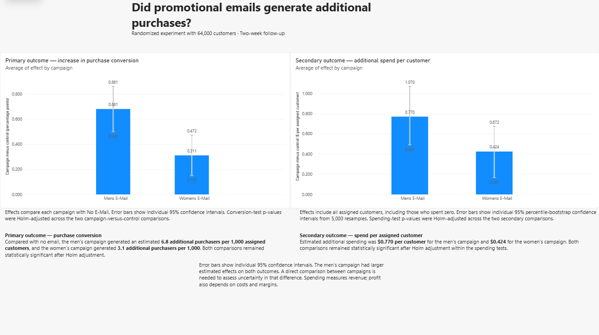

# email-campaign-incrementality
Causal analysis of a randomized email campaign using R, SQL, and Power BI, with hypothesis testing and bootstrap confidence intervals.

## Power BI dashboard

### Primary outcome — purchase conversion

Compared with no email, estimated conversion increased by 0.681 percentage points for the men's campaign and 0.311 percentage points for the women's campaign.

### Secondary outcome — spend per assigned customer

Estimated incremental spending was $0.770 per customer for the men's campaign and $0.424 for the women's campaign, including customers who spent zero.

*Effects are campaign minus control over two weeks. Conversion error bars show individual 95% proportion-test intervals. Spending error bars show individual 95% percentile-bootstrap intervals from 5,000 resamples. Both campaigns passed Holm-adjusted tests within each outcome's two-comparison family.*

Spending measures revenue. Costs and margins are needed to estimate profit.
